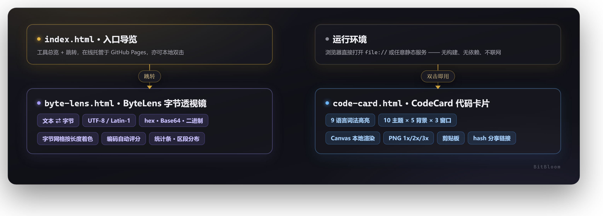

# BitBloom · 比特绽放

> 把看不见的比特，变成看得见的作品。

三个自包含的单文件网页小工具：**ByteLens 字节透视镜** 把文本拆成字节逐一检视，**CodeCard** 把代码转成高清分享卡片，**RepoCard** 把 GitHub 仓库做成带二维码的分享卡。
原生 HTML / CSS / JS，全内联、零依赖、不联网——下载任意一个 HTML 文件，双击就能跑。

为 **1024 造物挑战**（1024 程序员节）而作。

**在线体验：** https://2077fake.github.io/bitbloom/

---

## 快速开始

不需要 Node、不需要 Python、不需要构建：

```bash
# 方式一：直接双击
byte-lens.html
code-card.html
repo-card.html

# 方式二：起个静态服务（可选）
python -m http.server 8000
# 浏览器打开 http://localhost:8000
```

仓库入口页 `index.html` 汇总了三个工具的介绍与跳转。

---

## 工具一：ByteLens 字节透视镜

`byte-lens.html` — 文本 ⇄ 字节的双向检视

输入文本，实时看到它在 UTF-8 / Latin-1 下的字节构成；切换到十六进制或 Base64 模式粘贴字节流，则反向看三种编码各自读出什么。全部计算在本地完成。

**编码输出**（文本模式）

| 行 | 格式 |
|---|---|
| UTF-8 十六进制 | 按字符分组，每行累计不超过 8 字节，保留字符边界 |
| UTF-8 十六进制流 | 标准 hex dump，每行 8 字节 |
| UTF-8 Base64 | MIME 标准每行 76 字符，可直接用于 Data URL |
| UTF-8 二进制 | 每行 4 字节，便于逐位对照 |
| Latin-1 十六进制 / Base64 | 单字节编码，超出 U+00FF 时给出明确提示 |

排版上按两列网格组织：窄行（十六进制、二进制）左右并排，宽行（Base64）通栏；内容块收缩到实际行宽，不会为了填满容器而拉伸成空框。无论有没有 Latin-1 行，网格都是整齐的 2×N。

> 「复制」按钮写入剪贴板的是**无分隔连续串**（十六进制不带空格换行、Base64 不带换行），方便直接粘给其他工具；展示值才是分行后的 hex dump。

**反向解码**（字节模式）

- UTF-8 / GBK / Latin-1 三栏并排，同步显示解读结果
- 自动标注「最可能」的编码：按替换字符数量与字符数评分
- 支持容错解析：`0x` 前缀、任意空白分隔、大小写混合；奇数长度十六进制给出明确报错

**字节网格**

- 按字节数着色：1 字节灰 / 2 字节青 / 3 字节粉（CJK）/ 4 字节琥珀（Emoji）/ 异常红
- 悬停显示该字符的码位与字节明细
- 上限 300 字符，避免超长输入拖垮渲染

**统计条**：字符数、UTF-8 字节数、行数、BOM 检测、Unicode 区段分布（ASCII / 中日韩 / 符号占比）

---

## 工具二：CodeCard 代码卡片生成器

`code-card.html` — 代码 → 高清分享卡片

左边粘贴代码，右边实时渲染出带窗口样式与语法高亮的卡片。所有渲染都在浏览器本地 Canvas 完成，**代码不上传任何服务器**。

**语法高亮**
- 9 种语言：JavaScript / TypeScript / Python / Java / Go / Rust / C / C++ / SQL / JSON
- 粘贴时自动识别语言，也可按文件扩展名（拖入 `js` / `py` / `go` 等）判定
- 覆盖注释（含跨行块注释）、字符串（含 JS 模板字面量与插值）、数字、关键字、字面量、类型、函数调用、属性访问、常量、预处理器指令 / 装饰器

**视觉**
- 10 套配色主题：墨碳 / 深海 / 暮色 / 北境 / 琥珀 / 深林 / 晴空 / 竹简 / 樱雪 / 素笺
- 5 种背景：极光 / 晚霞 / 深空 / 蜜桃 4 种渐变 + 透明（导出的 PNG 带 Alpha 通道，可叠加到任意底色上）
- 3 种窗口样式：macOS 红黄绿三色灯 / 简约标题栏 / 无边框

**可控项**
- 字号、内边距、圆角、行号开关、文件名
- 指定行高亮，支持 `1,3-5` 区间语法
- 超长行自动折行，代码区最大宽度 880px

**输出**
- 1x / 2x / 3x 高清 PNG 导出
- 一键复制图片到剪贴板（`ClipboardItem`，失败时降级 `execCommand`）
- 分享链接：把当前全部设置编码进 `location.hash`，打开即可还原
- 快捷键 `Ctrl/⌘+S` 导出、`Ctrl/⌘+Enter` 复制

---

## 工具三：RepoCard 仓库分享卡生成器

`repo-card.html` — GitHub 仓库 → 带二维码的分享卡

左侧填写仓库信息，右侧实时渲染分享卡。**不请求 GitHub API**，所有内容只存在当前页面与分享链接里；二维码由内置的手写编码器在本地逐模块绘制。

**手写 QR 编码器**

- 完整实现 GF(256) 运算（本原多项式 `0x11D`）与 Reed-Solomon 纠错
- 块结构表覆盖版本 1–10（纠错级 M），支持多块与不等长块的数据交织
- 格式信息 BCH(15,5)（生成 `0x537`，掩码 `0x5412`）、版本信息 BCH(18,6)（生成 `0x1F25`）
- 8 种掩码全部计算后按四条罚分规则取最优，最长约 210 字节
- 解码往返验证通过：编码 → 读格式信息 → 去掩码 → 之字形读位 → 去交织 → 还原文本

**卡片内容**

- 头像占位（首字母色块）、拥有者 / 仓库名（超长自动缩字号或省略）
- 简介：中英混排折行，横卡最多 2 行、方卡最多 3 行，超出以省略号收尾
- 统计行：星标 / Fork / 关注（GitHub 式数字缩写：1.2k / 12k / 1.5M）+ 许可证 + 主页
- 语言占比条：按 GitHub Linguist 语言着色，超过 5 段合并为「其他」
- 标签药丸、底部仓库链接、右下二维码（白底圆角面板 + 4 模块静默区）

**视觉与输出**

- 6 套主题：奶霜 / 薄荷 / 晴空 / 樱雪（亮）+ 墨碳 / 深海（暗）
- 两种画布比例：横卡 1200×630（OG 分享图）、方卡 1080×1080
- 圆角 0–48 可调：整幅卡片按圆角裁切，导出的 PNG 四角为透明像素（带 Alpha 通道），可叠加到任意底色上
- 布局按「块流」计算：块高固定、间距在上下限内自适应，剩余空间整体垂直居中，任何内容组合都不溢出
- 1x / 2x / 3x PNG 导出、一键复制图片、分享链接编码进 `location.hash` 还原全部内容
- 统计图标（星标 / Fork / 关注 / 天平 / 地球）全部为手写矢量路径，无 emoji、无图标字体

---

## 架构



## 项目结构

```
.
├── index.html              入口页，工具导览
├── byte-lens.html          ByteLens 字节透视镜
├── code-card.html          CodeCard 代码卡片生成器
├── repo-card.html          RepoCard 仓库分享卡生成器（内置 QR 编码器）
├── LICENSE                 MIT
└── README.md
```

---

## 技术要点

几个在实现过程中真正踩到并解决的坑，记录备查：

**1. 粘性正则不能配 `^` 锚点**
`/^(?:...)/y` 中的 `^` 只在字符串第 0 位成立，导致扫描器从第二个字符起全部失配。粘性标志本身已锚定在 `lastIndex`，必须去掉 `^`。

**2. 字符串与注释必须原子化消费**
逐字符扫描时，字符串和注释要整体匹配后再前进光标。否则 `"https://x"` 里的 `//` 会被误判为行注释、`// don't` 里的撇号会被当成未闭合字符串吞掉后文、跨行块注释会丢失高亮。

**3. 属性访问优先于函数调用**
`obj.method()` 中的 `method` 应判为属性。且运算符连续扫描后需记录**末字符**，否则 `.` 被统一记成 `=`，属性识别失效。

**4. Canvas 缩放：只设宽度**
预览 canvas 若同时内联 `style.width` 与 `style.height`，在 `max-width:100%` 收缩时会被拉伸变形。只设宽度、交给 CSS `height:auto` 走 canvas 内在宽高比即可。

**5. `file://` 下的分享链接**
`location.origin` 在 file 协议下取值为 `"null"`，拼出的链接不可用；应以 `location.href.split('#')[0]` 作为前缀。

**6. 编码输出的「展示值」与「复制值」必须分开**
hex dump 为了可读要按 8 字节分行、按字符分组，但复制给别的工具时需要的是一整条无分隔连续串。两者混在一个变量里，要么显示难看，要么复制不可用。正确做法是给输出行加一个可选的 `copyValue` 参数，显示走分行格式，剪贴板走连续格式。

**7. 按字符分组分行不能按「条目数」切**
按每行 N 个字符折行会把一个 3 字节汉字劈到两行；应按**累计字节数**折行，且单字符超限时独占一行。

**8. QR 的剩余位不是字节对齐的**
版本 2–6 有 7 个非字节对齐的剩余位（v7–13 为 0，v14–20 为 3），编码时按规范留 0。解码器若按「全部非功能模块」读位，位流长度会多出几个比特，`bits.length / 8` 非整数直接抛 `RangeError`；必须按 `qrTotalCodewords(version) * 8` 截断。

**9. 定位图形的几何用中心距描述最稳**
以定位图形中心为原点，Chebyshev 距离 d≤1 是 3×3 暗芯、d=2 是浅环、d=3 是暗外框、d=4 是分隔符。且**定时图形要先画、定位图形后画**（后者覆盖前者），否则贴边的定位图形会把定时图形切出缺口。

**10. 块流式布局：间距自适应比固定间距抗造**
分享卡内容量波动大（简介 0–3 行、标签 0–8 个）。固定间距在内容少时显得空、内容多时溢出。做法是块高固定、间距在 `[gapMin, gapMax]` 内按剩余空间计算，剩余再多就整体垂直居中；触底时按「标签行数 → 间距」的顺序逐级收缩，保证任何组合都不溢出。

---

## 自测

开发过程中通过 Node + 无头 Chrome 双重验证：

- 50 项逻辑断言：词法边界、9 语言解析、语言自动识别、高亮行解析、排版渲染、150 组「主题 × 背景 × 窗口样式」组合、分享链接含中文往返、配置完整性
- 无头 Chrome 实测：整页布局、三套主题实渲染、JS / Python / Rust 着色、Python 缩进阶梯结构、分享链接端到端还原

ByteLens 部分：

- 分行函数断言：Base64 76 字符折行可还原、按字符分组在中文 / Emoji / 正好凑满一行三种边界下不拆散字符、hex dump 与二进制的行结构、`bytesToBase64` 与 Node `Buffer` 结果一致
- 无头 Chrome 实测：五种编码输出行的换行数与横向溢出、复制值均为无分隔连续串、窄屏（≤ 526px）下页面与统计卡无横向溢出

RepoCard 部分：

- QR 编码器 60 项断言：GF(256) 已知表值、RS 生成多项式与标准系数一致、v1–v10 总码字数与字节容量、校正图形坐标、矩阵结构不变量（定位图形 / 分隔符 / 定时图形 / 暗模块 / 格式信息双拷贝与 BCH / 版本信息双拷贝）、12 组载荷往返（覆盖全部 10 版本，含多块与不等长块）、编码确定性、8 掩码罚分、UTF-8 多字节、超长报错
- 无头 Chrome 实测 36 项断言：两种画布比例实渲染、六套主题背景色逐像素校验、语言条分段着色、二维码面板与暗模块、头像占位、超长仓库名收缩、清空 / 示例状态切换、分享链接往返、2x / 3x 导出画布尺寸与内容、表单驱动渲染、数字缩写、极端内容（超长简介 + 8 标签）不溢出
- 视觉走查：横卡 / 方卡 × 亮 / 暗主题截图逐项核对，二维码定位图形完整、模块清晰

---

## 许可

[MIT](./LICENSE) © 2026 oknoo
